# stick.ai

**Make the things around you shareable.**

<p align="center">
  <a href="https://chnclsr.github.io/stitcher/">
    
  </a>
</p>

> 🌐 **Public Live Demo:** [**https://chnclsr.github.io/stitcher/**](https://chnclsr.github.io/stitcher/)  
> *Deployed automatically to GitHub Pages on every push to `developments`.*

Take a photo, optionally name what should stay, and turn it into a transparent PNG.

**01 Capture** · **02 Choose an object** · **03 Save or share**

<p align="center">
  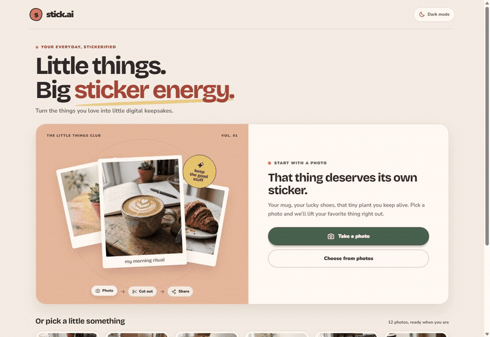
</p>

<p align="center">
  <sub>Full walkthrough recording available as <a href="docs/usage-demo.mp4">docs/usage-demo.mp4</a></sub>
</p>

## Screenshots

| 01. Home & Photo Capture | 02. Review & Object Guidance |
| :---: | :---: |
| 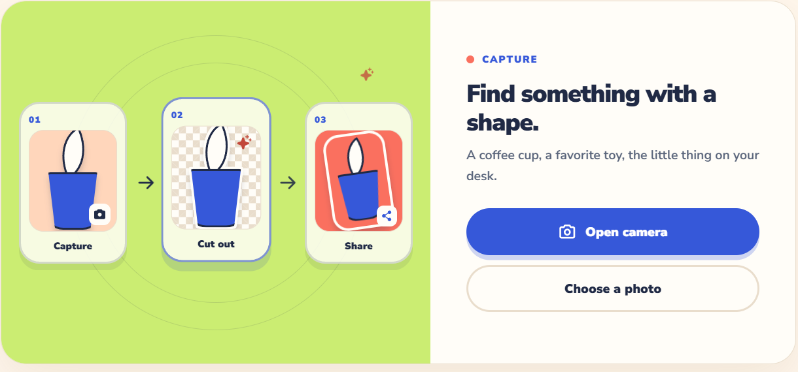 | 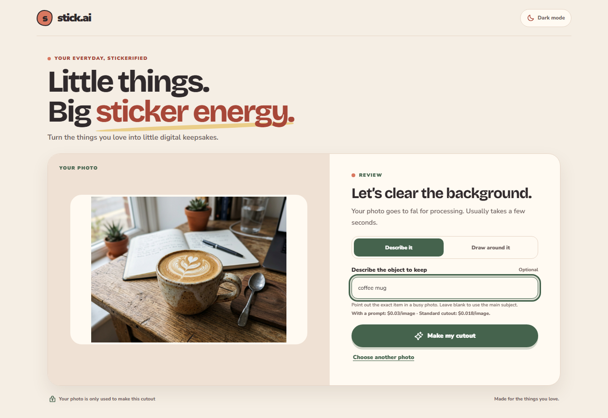 |

| 03. Transparent Asset Cutout | 04. Sticker Outline Mode |
| :---: | :---: |
| 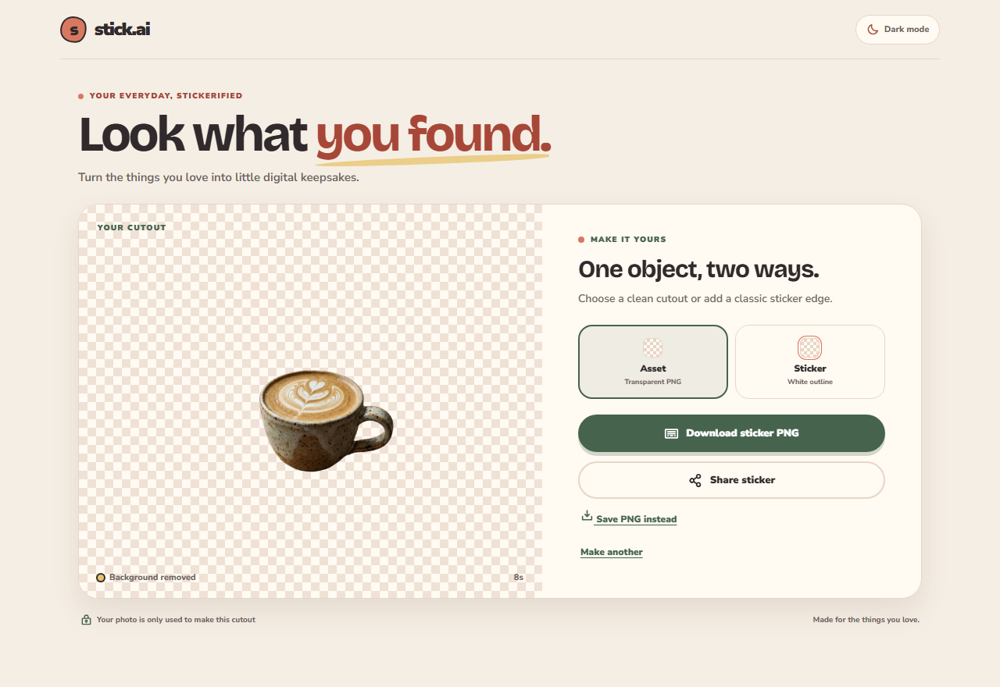 | 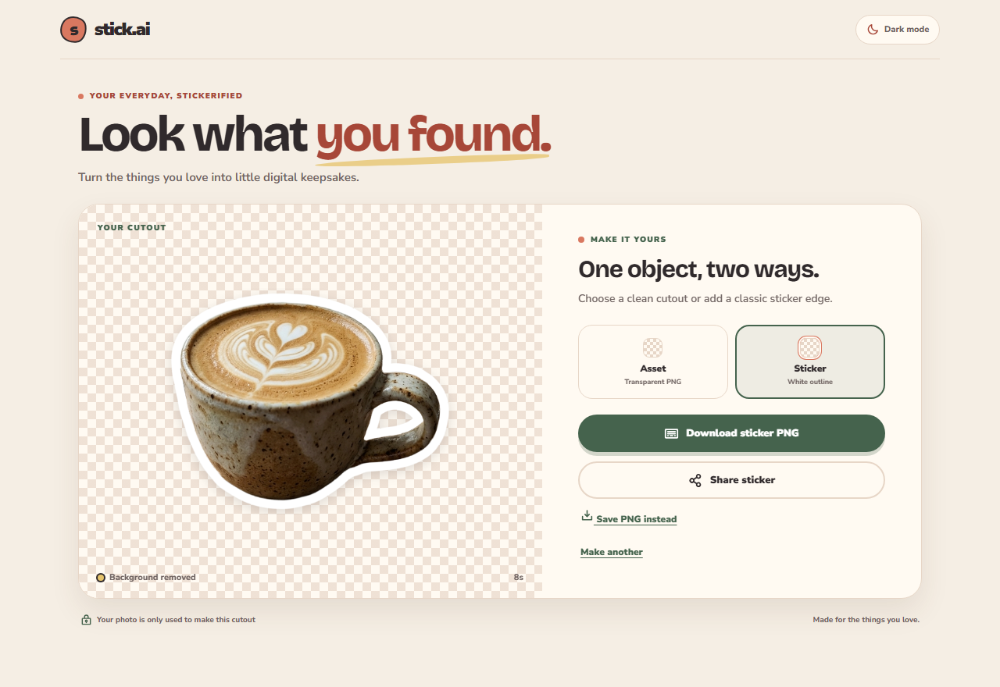 |

### Single & Multi-Object Extraction

Users can select the extraction mode during the review stage:
- **Single object**: Retains the entire selection area as a single combined sticker.
- **Multi-object**: Analyzes the background-removed image with 8-way connected component segmentation to isolate each distinct item (e.g. smartwatch, keys, AirPods, pocket knife, pen) into its own individual sticker, complete with an interactive thumbnail carousel and a one-click "Save all stickers" action.

<p align="center">
  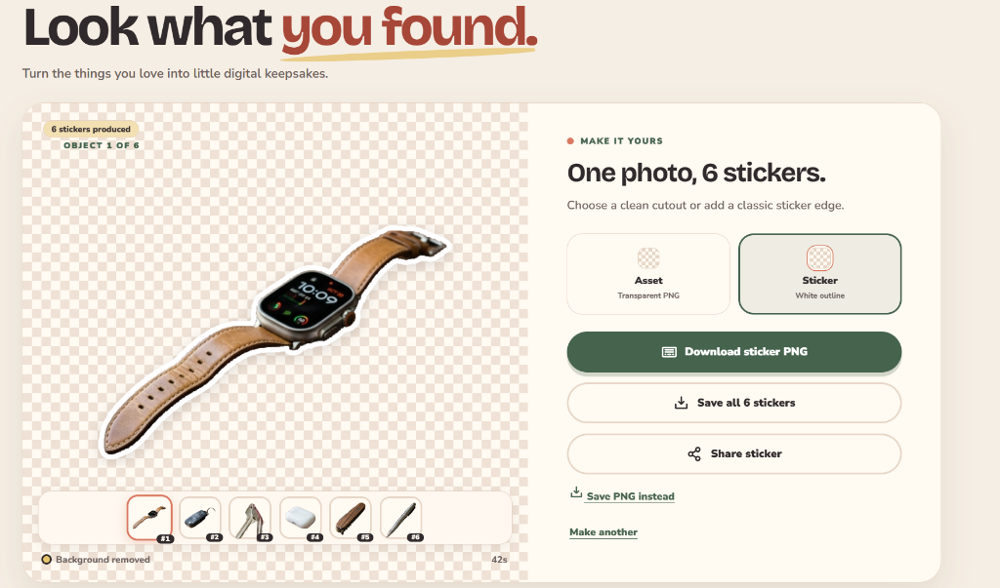
</p>

| Multi-Object Selection in Review | Multi-Object Result & Strip |
| :---: | :---: |
| 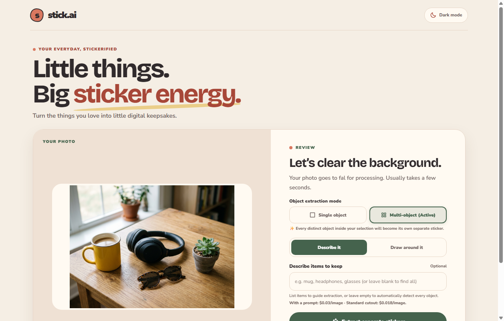 | 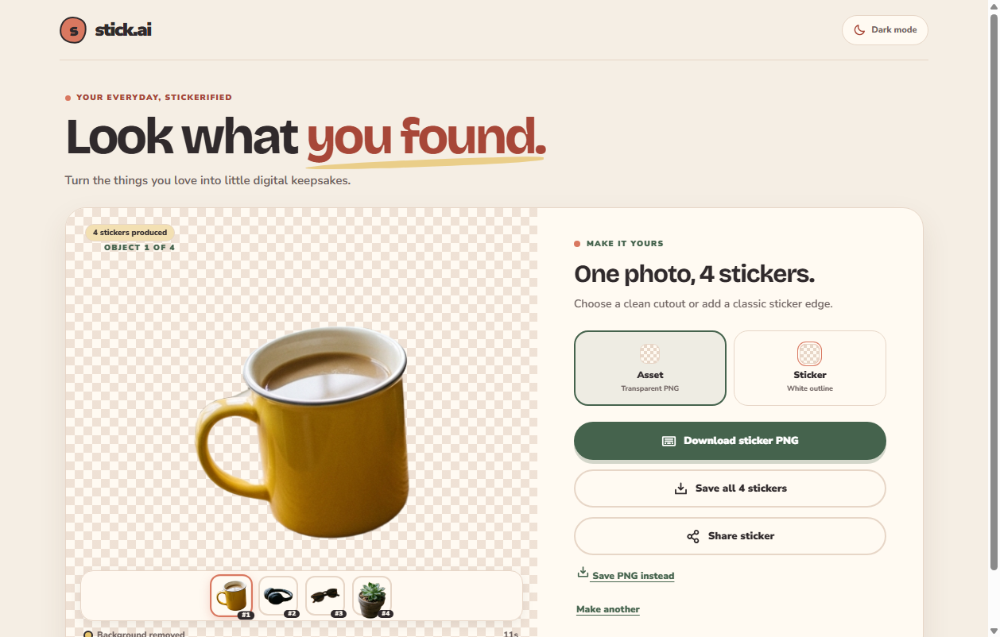 |

> **Processing today:** photos are sent to fal through the proxy. Processing happens in the cloud; live and on-device segmentation are not implemented.

## Run locally

Start the web app:

```bash
npm install
npm run dev
```

In a second terminal, configure `backend/.env` with `FAL_KEY`, then start the proxy. It requires Node.js 22 or newer. See [proxy setup](backend/README.md).

```bash
cd backend
npm install
npm run dev
```

Vite forwards `/api` requests to port 8788. Set `VITE_API_BASE_URL` when app and proxy use different hosts. Leave it empty for same-origin use.

## Public demo with GitHub Pages

The `Deploy web app to GitHub Pages` workflow builds and publishes the frontend whenever `developments` changes. After the first successful run, the site URL is `https://chnclsr.github.io/stitcher/`.

In repository **Settings → Pages**, set the publishing source to **GitHub Actions** if it is not already selected. For cutout processing outside the local network, deploy the proxy to a public Node.js host, set `FAL_KEY` on that host, then add repository variable `VITE_API_BASE_URL` with the proxy's HTTPS origin (no trailing slash). GitHub Pages hosts static files only; it cannot run the fal proxy. Keep `FAL_KEY` out of repository variables and the frontend.

## Android

Open the project in Android Studio with JDK 17 or 21 and an Android SDK. Then sync and launch:

```bash
npm run android:sync
npm run android:open
```

Test camera, save, and share on a physical phone.

## Architecture

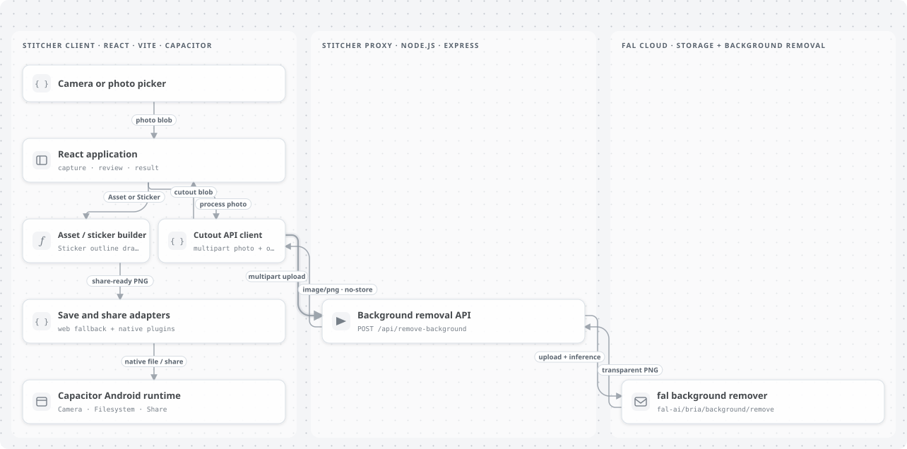

### Object guidance

Optional hints help select objects in complex photos.


### App lifecycle

Failed requests return to review for retry.


See the [architecture guide](docs/ARCHITECTURE.md) for API behavior and limits. Editable sources: [object guidance](docs/diagrams/object-guidance.html) · [app lifecycle](docs/diagrams/capture-lifecycle.html).
## Checks

```bash
npm run build
npm run build:proxy
npm run test:proxy
```

## Photo handling

- Photos go to the stick.ai proxy and fal for processing. Check provider retention settings before public deployment.
- Proxy allows uploads up to 10 MB and limits each client IP to 12 requests per minute.
- Keep `FAL_KEY` on the proxy. Never add it to the web app, Android package, or Git history.
- Public deployment needs stronger abuse controls and a clear image-retention policy.
