# stick.ai

One tap turns a real-world object into a transparent, share-ready digital asset—without editing or switching apps.

stick.ai is a web-native cross-platform app packaged for Android with Capacitor. It processes captured still images through fal in the cloud; it does not perform live or on-device segmentation.

## Current flow

1. Capture a photo with the device camera or choose an image.
2. Review it, then send it to the stick.ai proxy.
3. Preview the transparent PNG on a checkerboard.
4. Choose Asset or Sticker mode.
5. Download/save the PNG or open the native share sheet.

## Architecture and data flow

These diagrams describe the current implementation. See [the architecture guide](docs/ARCHITECTURE.md) for component details, API behavior, and limits. The editable PR Lens source is in [`docs/diagrams/graph.json`](docs/diagrams/graph.json).




## Stack

- React, TypeScript, Vite, responsive CSS
- Capacitor Camera, Filesystem, and Share plugins
- Node.js/TypeScript proxy with fal `fal-ai/bria/background/remove`
- `FAL_KEY` stays on the proxy server

Platform actions live in `src/platform/`. The UI calls `captureImage()`, `saveImage()`, and `shareImage()` rather than calling Capacitor directly.

## Run the web app

```bash
npm install
npm run dev
```

Start the proxy in a second terminal using [backend/README.md](backend/README.md). Vite forwards local `/api` requests to port 8788. Set `VITE_API_BASE_URL` to the deployed proxy URL when frontend and backend use different hosts. Leave it empty for a same-origin deployment.

## Android

Open the project in Android Studio with JDK 17 or 21 and an installed Android SDK, then run:

```bash
npm run android:sync
npm run android:open
```

Build and test camera, save, and share on a physical phone. This host has Java 25 and no Android SDK. Gradle 8.14.3 rejects the Java 25 class format, so APK packaging remains unverified here.

## Checks

```bash
npm run build
npm run build:proxy
npm run test:proxy
```

## Demo

Show the installed Android flow: problem (20s), capture and processing (30s), transparent result (30s), save/share (20s), impact and next step (20s). Keep one minute for Q&A. Report measured processing time. Explain that fal processes the captured image in the cloud.

## Privacy and limits

- The photo is sent to the stick.ai proxy and fal for processing.
- The proxy limits uploads to 10 MB by default, checks file signatures, and rate-limits requests to 12 per minute per client IP.
- Never put `FAL_KEY` in the web app, Android package, or Git history.
- Public deployment needs stronger abuse controls and an explicit image-retention policy.
